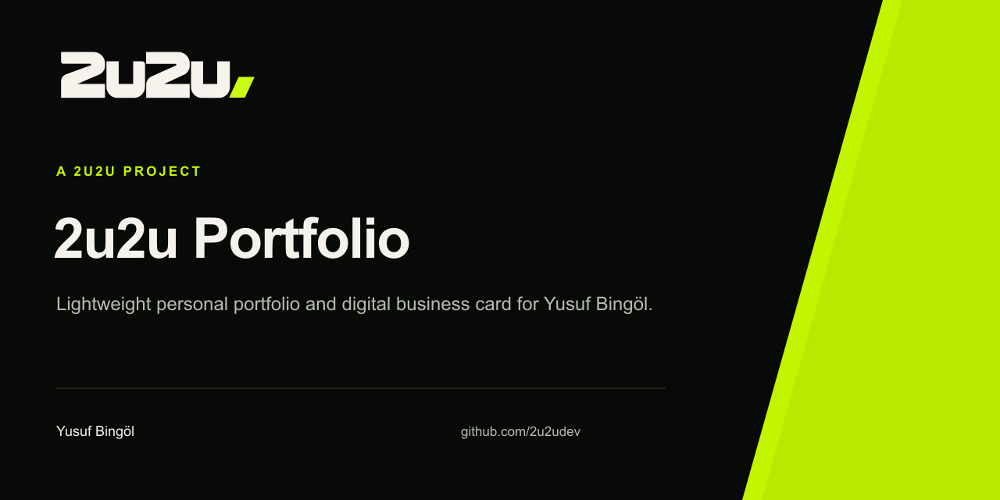

# 2u2u Portfolio

Lightweight personal portfolio and digital business card for Yusuf Bingöl.

[View project](https://zuzuverseweb.pages.dev) · [Portfolio](https://zuzuverseweb.pages.dev/) · [Yusuf Bingöl](https://github.com/2u2udev)

## Overview

A responsive, buildless digital business card with project categories and a separate services section. Images are optimized for the web; there are no animation loops or external font requests.

Run locally with `python -m http.server 4173`, then open `http://localhost:4173`. No dependency installation is required.
